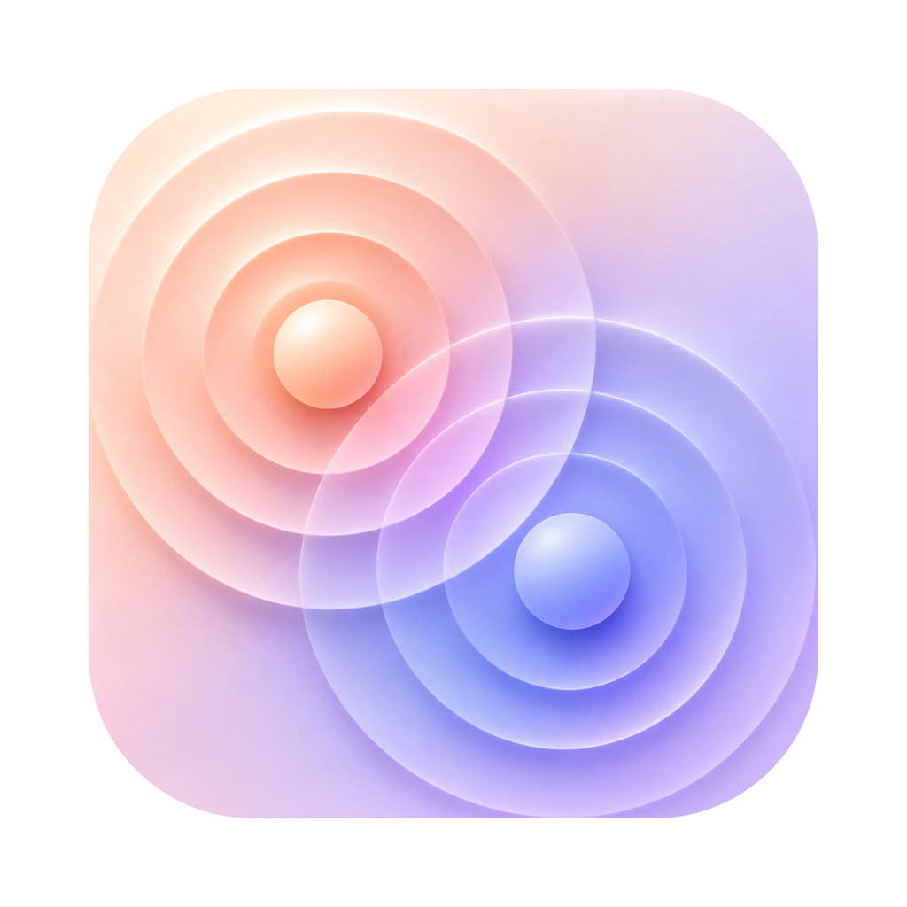

<p align="center"></p>

# iPhonify

iPhone-style gestures for your Mac. Swipe upward with two fingers from the bottom edge of your trackpad to return from a fullscreen app to your desktop.

## Download

[Download iPhonify for macOS](https://github.com/maxim-kich/iPhonify/releases/latest).

Requires an Apple Silicon Mac, macOS 14 or later, and a compatible trackpad.

## Getting started

1. Move iPhonify to Applications and open it.
2. Allow **Accessibility** and **Screen Recording** in the welcome window.
3. Turn on **Activate** from the menu bar or Settings.
4. In a native fullscreen app, place the pointer over its window and swipe upward from the trackpad’s bottom edge. Reverse the gesture or press **Escape** to cancel.

Settings includes activation, permission status, Launch at login, and Hide from Dock. About includes **Check for Updates**. Downloading an update and restarting each require your confirmation.

## Build

Requires Xcode with the macOS 26 SDK or newer.

```sh
./build.sh
```

The app is created at `build/iPhonify.app`. For local permission testing, use a stable Apple-issued signing identity:

```sh
SIGN_IDENTITY='Developer ID Application: Your Name (TEAMID)' ./build.sh
```

## Privacy and licenses

Screen images stay in memory. No analytics or telemetry.

[Privacy](PRIVACY.md) · [Contributing](CONTRIBUTING.md) · [Licenses & Acknowledgements](ACKNOWLEDGEMENTS.md)

GPL-3.0-only. iPhonify is an independent project and is not affiliated with Apple.
